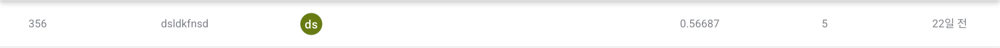
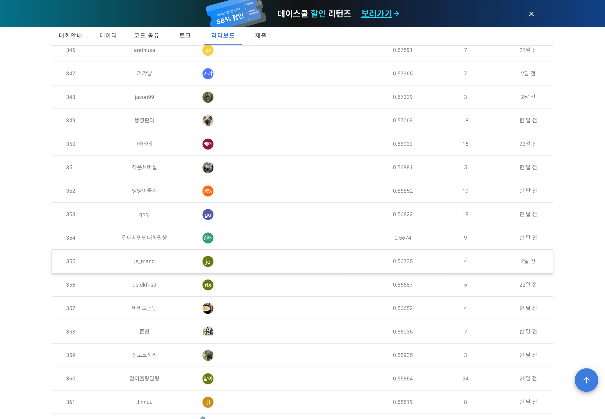
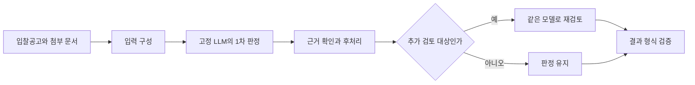

<div align="center">

# G2B → Procurement Compliance

### 고정 LLM으로 입찰공고의 법령 위반을 찾는 추론 파이프라인 실험

**나라장터 자체입찰 공고 법령 위반사항 모니터링 AI 경진대회**


[대회 페이지](https://dacon.io/competitions/official/236754/overview/description) · [상세 회고](docs/retrospective.md) · [결과 기록](docs/results.json) · [공개 범위](docs/publication_policy.md)

</div>

---

## 결과부터 보기

| 공식 리더보드 표시 점수 ↑ | 점수 등록 팀 중 순위 | 최신 로컬 후보 |
|:---:|:---:|:---:|
| **0.56687** | **356위 / 607팀** | **v12 — 서버 결과 연결 미확인** |

2026-10-21(KST)에 [공식 리더보드](https://dacon.io/competitions/official/236754/leaderboard)의 전체보기에서 **`dsldkfnsd`** 기록을 확인했습니다. 607은 점수가 등록된 팀 수이며 참가 신청 인원과 다릅니다. 이 순위는 공개 화면의 리더보드 순위이며 수상 순위를 뜻하지 않습니다.

현재 표시 점수는 과거 로컬 기록의 v9 제출 점수 **0.5618889391**과 다릅니다. 현재 점수에 대응하는 제출 버전은 확인되지 않아 v12의 성과로 연결하지 않았습니다. 과거 제출 기록은 아래에 별도로 남겼습니다.

### 공식 리더보드 캡처



<details>
<summary>주변 순위가 포함된 공식 화면 펼치기</summary>



</details>

실제 브라우저 화면을 수정 없이 캡처했습니다. [출처와 촬영 시각](evidence/leaderboard/source.json)

이 저장소는 **프로젝트 소개와 집계 결과를 담은 문서 아카이브**입니다. 공식 공개 리더보드 캡처를 포함하며, 배포 데이터와 실행 코드는 포함하지 않습니다. 판단 근거는 [공개 범위](docs/publication_policy.md)에 정리했습니다.

## 왜 이 프로젝트를 진행했나

입찰공고의 법령 위반 여부는 특정 단어가 등장했다는 이유만으로 결정하기 어렵습니다. 같은 표현도 참가자격, 계약 이후 의무, 기존 설비 설명 중 어디에 쓰였는지에 따라 의미가 달라집니다.

이 프로젝트는 **모델을 추가 학습하지 않고 입력 구성과 근거 확인, 후처리를 개선해 판정의 신뢰도를 높일 수 있는지** 확인하는 도전이었습니다. 개발 정답 자료 200건을 활용하고 공고별 24개 항목의 위반 여부와 근거를 다뤘습니다. 지정 모델 기반 추론 및 제공 자료만 활용하는 조건은 [공식 규칙](https://dacon.io/competitions/official/236754/overview/rules)을 따랐습니다.

## 어떻게 접근했나

문서를 모델이 읽을 수 있는 입력으로 정리하고 판정과 원문 근거가 일치하는지 확인했습니다. 이후 오탐이 발생하는 문맥을 구분하고 일부 양성 판정에 같은 모델의 추가 검토를 적용했습니다.



*개발 접근을 설명하는 개념도입니다. 실행 코드·프롬프트·판정 규칙 및 원문 예시는 공개하지 않습니다.*

- **입력:** 문서 길이와 근거 보존을 함께 점검하고 발췌 방식 비교.
- **판정:** 문맥에 따른 오탐과 누락을 구분하고 후처리 개선.
- **검토:** 일부 양성 결과에 같은 모델의 추가 추론 적용.
- **검증:** 응답 형식, 원문 근거, 실패 처리, 제출 패키지 재현 점검.

## 이전 접근보다 무엇이 발전했나

| 단계 | 평가 범위 | 점수 또는 결과 | 의미 |
|---|---|---|---|
| v2 | 사용자 전달 공식 채점 | 0.2609815205 | 첫 성공 제출 기준점 |
| v9 | 사용자 전달 공식 채점 | **0.5618889391** | 마지막으로 기록된 공식 결과 |
| v12 / 응답 기록 A | 반복 개발 200건 | 0.84136 → 0.85078 | 오탐 5개 감소, 새 오판 0개 |
| v12 / 응답 기록 B | 동일 개발 200건 | 0.81495 → 0.84762 | 오탐 16개 감소, 새 오판 0개 |

공식 점수와 로컬 점수는 평가 환경과 대상이 다릅니다. A와 B는 **같은 개발 자료에 대한 서로 다른 추론 응답 기록**이며 독립 데이터셋 두 개가 아닙니다. 여러 변경이 누적되었으므로 공식 개선량을 특정 기법 하나의 효과로 해석할 수 없습니다.

### 1. 입력을 늘리는 것에서 근거를 보존하는 것으로

키워드 중심 발췌가 항상 좋은 결과를 주지는 않았습니다. 문장을 줄이는 과정에서 필요한 문맥을 잃을 수 있어 입력 길이뿐 아니라 실제 근거가 남는지도 확인했습니다.

### 2. 판정 수를 늘리는 것에서 오탐을 설명하는 것으로

더 많은 위반을 찾는 것만으로는 충분하지 않았습니다. 표현의 적용 대상을 구분하고 이미 맞게 판단한 항목을 유지하면서 잘못된 양성을 줄이는 방향으로 검증했습니다.

### 3. 최신 후보와 실제 채점 결과를 분리한 것

v12는 로컬 검증을 통과했지만 공식 점수는 확인되지 않았습니다. 실행 안정성, 반복 개발 성능, 서버 채점 결과를 각각 기록해 아직 입증되지 않은 개선을 구분했습니다.

## 어디서 막혔나

### 개발 점수와 서버 점수의 차이를 해소하지 못했다

로컬은 Apple Silicon의 MLX 4비트 환경, 서버는 별도 추론 환경이었습니다. 정밀도·런타임·평가 자료 구성 차이가 가능한 원인이지만 어느 요인이 격차를 만들었는지 입증하지 못했습니다.

### 같은 200건을 반복해서 보고 있었다

오류를 보며 규칙과 설정을 수정했기 때문에 로컬 점수가 높아져도 새 공고에서 같은 개선이 유지된다고 볼 수 없습니다. 다른 응답 기록으로 재검사하는 것 역시 새 정답 데이터에서의 검증을 대체하지 못했습니다.

### 추가 검토의 실제 서버 비용을 확인하지 못했다

같은 모델을 한 번 더 호출하면 실행시간이 늘어납니다. v12의 전체 서버 실행시간은 측정하지 못했습니다. 새 공고 16건을 점검했으나 추가 검토 대상이 없어 재검토 정확도를 검증하는 증거로도 사용할 수 없었습니다.

## 다음에는 어떻게 개선할 것인가

| 우선순위 | 다음에 바꿀 행동 | 확인할 증거 |
|---|---|---|
| **1. 서버 기준선 조기 확보** | 초기에 실제 평가 환경에서 기본 파이프라인 완주 | 로컬·서버 응답 차이와 시간 |
| **2. 확인 평가 분리** | 반복 개발과 마지막 확인용 평가를 사전에 구분 | 자료 재사용 기록과 새 평가 결과 |
| **3. 오류 유형별 가설** | 입력 손실·문맥 오독·근거 오류를 분리해 실험 | 각 개입의 효과와 부작용 |
| **4. 재검토 비용 측정** | 추가 호출의 정확도와 시간을 함께 비교 | 처리량, 오류 감소, 시간 상한 |
| **5. 최종 채점 시간 확보** | 후보 검증과 실제 제출 사이에 여유 확보 | 최종 후보의 공식 점수와 실행시간 |

## 기록과 재현

| 자료 | 내용 |
|---|---|
| [리더보드 증빙](evidence/leaderboard/source.json) | 공식 화면과 확인 시각 |
| [상세 회고](docs/retrospective.md) | 접근의 변화, 검증 범위와 남은 한계 |
| [결과 기록](docs/results.json) | 집계 수치, 출처 유형, 검증 시점 |
| [공개 범위](docs/publication_policy.md) | 확인한 규정과 제외 대상 |

```text
g2b/
├── README.md
├── evidence/leaderboard/  # 공식 화면 캡처와 출처
├── docs/
│   ├── retrospective.md
│   ├── results.json
│   └── publication_policy.md
└── .gitignore
```

이 문서만으로 추론을 실행하거나 점수를 재현할 수는 없습니다. 데이터는 [공식 대회 페이지](https://dacon.io/competitions/official/236754/data)의 이용 조건을 따라야 합니다. 소스·가중치·예측·제출 ZIP·개별 공고 정보는 이 저장소에서 배포하지 않습니다.
